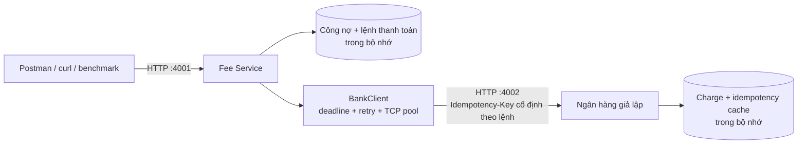

# PTIT · Lab 3: Kết nối và duy trì kết nối giữa các service

Hệ thống thanh toán học phí theo đề `lab-ket-noi-noi-dung-PTIT-de-bai.docx`: hai tiến trình TypeScript/Express độc lập, dữ liệu trong bộ nhớ, giao tiếp HTTP. Có timeout, retry, idempotency và tái sử dụng kết nối TCP.

## Chạy nhanh

Cần Node.js từ **18.20** và **pnpm 10**. Phiên bản pnpm được khóa bằng trường `packageManager`.

```bash
pnpm install --frozen-lockfile
pnpm dev
```

- Fee Service: `http://localhost:4001`
- Ngân hàng giả lập: `http://localhost:4002`
- Dừng cả hai: `Ctrl+C`.

Chạy bản biên dịch bằng `pnpm build` rồi `pnpm start`. Khi chạy riêng từng service bằng `pnpm start:fee` / `pnpm start:bank`, cũng cần build trước.

Thử một thanh toán:

```bash
curl http://localhost:4001/students/1/fees
curl -i -X POST http://localhost:4001/students/1/payments \
  -H 'Content-Type: application/json' -d '{"amount":100000}'
curl http://localhost:4001/students/1/fees
curl http://localhost:4002/stats
```

Thanh toán đầu tiên trả `201`, `paymentId: "P1"`, `status: "PAID"`; công nợ sinh viên 1 còn `49900000` đồng.

Để làm lab và khởi động lại ngân hàng riêng, dùng hai terminal:

```bash
# Terminal 1
pnpm start:fee
```

```bash
# Terminal 2
pnpm start:bank
```

Mỗi lần đổi `DELAY_MS`, `FAIL_RATE`, `DROP_RATE`, chỉ cần dừng và chạy lại tiến trình ngân hàng với biến mới. Khởi động lại một service sẽ xóa bộ nhớ của service đó. Bắt đầu mỗi phép đo độc lập bằng việc chạy mới cả hai, trừ bài kiểm tra Fee Service sống qua lúc ngân hàng tắt/bật.

## Kiến trúc và nguyên tắc



Fee Service sở hữu công nợ và các lệnh `P1`, `P2`… Ngân hàng sở hữu giao dịch trừ tiền; Fee chỉ giao tiếp với ngân hàng qua HTTP. GET công nợ đọc bộ nhớ của Fee nên vẫn hoạt động khi ngân hàng gặp lỗi.

Mỗi lệnh có một `Idempotency-Key` được tạo một lần. Tất cả lần thử lại dùng đúng khóa và nội dung cũ. Ngân hàng lưu charge **trước** khi mô phỏng cắt kết nối; request lặp trả lại charge đã có và bỏ qua giả lập lỗi. Nếu cùng khóa nhưng khác reference/amount thì trả `409`.

Ngân hàng kiểm tra lại cache sau thời gian trì hoãn. Đoạn kiểm tra và lưu charge không có `await`, ngăn hai request cùng khóa trừ tiền đồng thời trong một tiến trình. Ngân hàng vẫn đếm được `duplicates` nếu client dùng các khóa khác nhau cho cùng reference; chỉ số này không bị cố định về 0.

Fee giữ chỗ số tiền trước khi gọi ngân hàng để các request đồng thời không vượt công nợ. Chỉ khi nhận xác nhận charge hợp lệ mới giảm `outstanding`. Khi `FAILED`, giải phóng phần giữ chỗ. Khi `PENDING`, giữ nguyên công nợ và phần giữ chỗ cho đến khi truy lại được kết quả.

## Hợp đồng API

Tất cả số tiền là số nguyên dương theo VND; không nhận chuỗi số hoặc số thập phân.

| Service | Method và URL                 | Nội dung                                                                     |
| ------- | ----------------------------- | ---------------------------------------------------------------------------- |
| Fee     | `GET /students/:id/fees`      | `{studentId, outstanding, reserved, available}`                              |
| Fee     | `POST /students/:id/payments` | Body `{"amount":100000}`; tạo lệnh mới                                       |
| Fee     | `GET /payments/:id`           | Xem trạng thái đã lưu của lệnh, không tự gọi ngân hàng                       |
| Fee     | `POST /payments/:id/retry`    | Thử lại lệnh PENDING bằng khóa cũ; lệnh PAID trả lại kết quả cũ              |
| Fee     | `GET /health`                 | Trạng thái tiến trình Fee, không phụ thuộc ngân hàng                         |
| Bank    | `POST /charges`               | Body `{"reference":"P1","amount":100000}`, bắt buộc header `Idempotency-Key` |
| Bank    | `GET /stats`                  | `{connections, requests, charges, duplicates}`                               |
| Bank    | `GET /health`                 | Trạng thái tiến trình ngân hàng                                              |

Công nợ ban đầu: sinh viên `1` nợ `50.000.000`, `2` nợ `0`, `3` nợ `3.200.000` đồng. `available = outstanding - reserved` là phần có thể tạo thêm lệnh thanh toán.

Phản hồi thành công của Fee:

```json
{
  "paymentId": "P1",
  "studentId": "1",
  "amount": 100000,
  "status": "PAID",
  "attempts": 1,
  "chargeId": "C1"
}
```

| Tình trạng                                        | HTTP              | status  | Xử lý công nợ                        |
| ------------------------------------------------- | ----------------- | ------- | ------------------------------------ |
| Ngân hàng xác nhận charge                         | 201               | PAID    | Giảm công nợ và giải phóng giữ chỗ   |
| Ngân hàng từ chối 4xx rõ ràng                     | Giữ mã, ví dụ 402 | FAILED  | Giải phóng giữ chỗ; không retry      |
| Chưa kết nối được / 500 trước trừ tiền, hết retry | 503               | FAILED  | Giải phóng giữ chỗ                   |
| Timeout khi đã kết nối / mất phản hồi             | 504               | PENDING | Giữ nguyên công nợ, tiếp tục giữ chỗ |

Mọi lỗi của Fee có `error`, `paymentId`, `status`. Lỗi đầu vào chưa tạo lệnh dùng `paymentId: null`, `status: "FAILED"`. Lỗi trả về từ lệnh đã tạo luôn có ID để tra cứu.

Nếu một lần trước đã có kết quả không chắc chắn, các lần retry sau vẫn giữ `PENDING` khi ngân hàng không kết nối được. Không biến một lệnh có thể đã trừ tiền thành `FAILED` chỉ vì lần truy lại gặp lỗi kết nối.

## Timeout, retry và kết nối TCP

| Cơ chế                | Mặc định                                        | Mục đích                                                   |
| --------------------- | ----------------------------------------------- | ---------------------------------------------------------- |
| Deadline toàn bộ lệnh | 4.000 ms                                        | Bao gồm chờ socket, DNS, kết nối, đọc body, retry, backoff |
| Deadline mỗi lần thử  | 1.200 ms                                        | Không bị giữ quá lâu ở một lần gọi                         |
| Giới hạn chờ kết nối  | 700 ms                                          | Ngân hàng chưa lên thì trả nhanh                           |
| Số lần gọi tối đa     | 4, tính cả lần đầu                              | Retry lỗi 5xx và lỗi mất phản hồi                          |
| Backoff               | 100, 200, 400 ms                                | Tránh gọi dồn ngay sau lỗi                                 |
| Agent                 | keepAlive, tối đa 20 socket, giữ 10 socket rảnh | Chia sẻ pool cho toàn bộ Fee Service                       |
| Socket rảnh ở client  | 4 giây                                          | Loại socket cũ trước hạn của ngân hàng                     |
| Socket rảnh ở bank    | 5 giây                                          | Đúng yêu cầu đề; ghi log mỗi kết nối mới                   |

Timer chủ động hủy request, không chỉ đăng ký sự kiện timeout. Hết deadline mà chưa có xác nhận thì trả `PENDING`. Mỗi lần thử chỉ dùng ngân sách còn lại, nên retry không kéo tổng thời gian lên quá giới hạn 4,5 giây của đề trong điều kiện chạy lab.

Retry chỉ diễn ra ở BankClient. Lỗi 4xx dừng ngay. Với ngân hàng giả lập này, lỗi 5xx được cam kết xảy ra trước khi trừ tiền; cổng ngân hàng thực tế cần hợp đồng tương ứng để phân loại như vậy.

### Xử lý PENDING

```bash
curl http://localhost:4001/payments/P1
curl -i -X POST http://localhost:4001/payments/P1/retry
```

Retry chỉ truy lại/thực hiện **cùng lệnh**, không tạo P2. Các request retry đồng thời được gộp để công nợ chỉ cập nhật một lần. Lệnh FAILED trả `409` khi yêu cầu retry; sinh viên có thể tạo lệnh mới.

Có thể demo PENDING do đã trừ tiền nhưng mất phản hồi bằng cách chạy Fee với `MAX_ATTEMPTS=1` và bank với `DROP_RATE=1`. Lần đầu trả `504`; retry P1 trả `201` từ cache, `charges` vẫn bằng 1.

## Thực hành bốn tình huống

Import [bộ request Postman](postman/PTIT-SOA-Lab.postman_collection.json), hoặc dùng curl như bên dưới. Khi thử sự cố, dùng hai terminal riêng cho hai service.

### 1. Ngân hàng chưa chạy, sau đó hoạt động lại

Chỉ chạy Fee, để ngân hàng tắt:

```bash
pnpm start:fee
```

```bash
curl -i -w '\nTime: %{time_total}s\n' \
  -X POST http://localhost:4001/students/1/payments \
  -H 'Content-Type: application/json' -d '{"amount":100000}'
curl -w '\nTime: %{time_total}s\n' http://localhost:4001/students/1/fees
```

Kỳ vọng `503/FAILED` dưới 1,5 giây, GET vẫn nhanh. Chạy ngân hàng bằng `pnpm start:bank`, gọi lại POST; kỳ vọng `201` mà không restart Fee.

Để thử cấu hình sai địa chỉ, chạy Fee mới bằng `BANK_URL=http://localhost:4999 pnpm start:fee`; kết quả tương tự khi cổng 4999 không có ngân hàng. Chạy `BANK_PORT=4999 pnpm start:bank` thì Fee đó lại thanh toán được.

### 2. Ngân hàng phản hồi chậm

Chạy lại ngân hàng:

```bash
DELAY_MS=5000 pnpm start:bank
```

POST thanh toán trả `504/PENDING` khoảng 4 giây. Để gửi 20 thanh toán đồng thời:

```bash
pnpm bench 20 20
```

Trong lúc đó, terminal khác gọi GET công nợ; kỳ vọng dưới 300 ms. Benchmark dùng exit code 1 khi có lệnh không thành công, nên exit 1 ở tình huống này là dự kiến. Các khoản PENDING vẫn giữ chỗ; ngân hàng có thể hoàn tất trừ tiền sau khi Fee đã hết thời gian chờ.

### 3. Duy trì kết nối

Chạy mới hai service với cấu hình mặc định, sau đó:

```bash
pnpm bench 200 10 --idle
```

Kỳ vọng `200/200 PAID`, `newBankConnections <= 20`, `duplicates = 0`; sau nhàn rỗi 6 giây, `5/5 PAID`. Giá trị connections trong kết quả là chênh lệch trước/sau batch; không tính kết nối ban đầu của chính request đọc stats.

Để đo đối chứng, chạy lại Fee với `KEEP_ALIVE=false pnpm start:fee` và ngân hàng mới, rồi chạy cùng benchmark. `keepAlive: false` được cấu hình tường minh trên agent riêng vì mặc định global agent khác nhau giữa các phiên bản Node.

### 4. Cắt kết nối, lỗi tạm thời và từ chối

Mỗi kiểu dùng dữ liệu mới, không trộn các phép đo:

```bash
# 4a: ngân hàng đã trừ tiền rồi cắt kết nối
DROP_RATE=0.3 pnpm start:bank
# Ở terminal khác
pnpm bench 60 1
```

```bash
# 4b: ngân hàng trả 500 trước khi trừ tiền
FAIL_RATE=0.3 pnpm start:bank
# Ở terminal khác
pnpm bench 60 1
```

Kỳ vọng ít nhất 54/60 PAID, `duplicates = 0`. Với DROP, lệnh không được xác nhận phải là `504/PENDING`. Công nợ bằng `50000000 - tổng amount các lệnh PAID`; charges có thể lớn hơn số lệnh PAID nếu còn PENDING đã trừ tiền.

Với bank mới, gọi thanh toán `25000000` đồng cho sinh viên 1: kỳ vọng `402/FAILED`, `/stats.requests = 1`, `/stats.charges = 0`. Xem số liệu bằng `curl http://localhost:4002/stats`.

## Kiểm thử và báo cáo

```bash
pnpm check     # TypeScript strict, ESLint có thông tin kiểu, Prettier
pnpm test      # Kiểm thử HTTP/TCP thật, bao gồm bốn tình huống
pnpm lab       # Đo đối chứng và bản hoàn thiện, xuất báo cáo
```

Test và runner dùng cổng ngẫu nhiên, dữ liệu độc lập, tự dọn server khi xong. Không cần dừng các service đang chạy ở 4001/4002. Bộ test có cả race của idempotency, thanh toán đồng thời vượt nợ, PENDING và retry đồng thời.

`pnpm lab` ghi [bảng kết quả](docs/lab-results.md) và [JSON chi tiết](docs/lab-results.json). Đối chứng là cùng mã với timeout 15 giây, một lần gọi, không keep-alive; không giả định có mã nguồn cũ. TH1 và lỗi 4xx dùng chung cách xử lý nên có thể đã đạt ngay trong đối chứng. Runner dùng bộ sinh ngẫu nhiên seed 7 để lặp lại kết quả; các service khởi chạy bình thường dùng `Math.random` đúng theo FAIL_RATE/DROP_RATE.

Xem thêm [bảng đối chiếu từng yêu cầu và dàn ý demo](docs/assignment-checklist.md) để chuẩn bị trình bày bài lab.

## Cấu hình

Các entrypoint tự nạp `.env` bằng dotenv. Biến đã export trong terminal được ưu tiên hơn giá trị trong `.env`. Tạo file cấu hình bằng:

```bash
cp .env.example .env
pnpm dev
```

| Biến                  | Mặc định              | Service / công cụ                              |
| --------------------- | --------------------- | ---------------------------------------------- |
| BANK_URL              | http://localhost:4002 | Fee, benchmark; HTTP hoặc HTTPS cho BankClient |
| FEE_PORT / BANK_PORT  | 4001 / 4002           | Service tương ứng                              |
| DELAY_MS              | 0                     | Bank; độ trễ trước xử lý charge mới            |
| FAIL_RATE / DROP_RATE | 0 / 0                 | Bank; giá trị từ 0 đến 1                       |
| PAYMENT_TIMEOUT_MS    | 4000                  | Fee; deadline tổng                             |
| ATTEMPT_TIMEOUT_MS    | 1200                  | Fee; deadline mỗi lần thử                      |
| CONNECT_TIMEOUT_MS    | 700                   | Fee; thời gian chờ kết nối                     |
| MAX_ATTEMPTS          | 4                     | Fee; từ 1 đến 10                               |
| KEEP_ALIVE            | true                  | Fee; đặt false để đo đối chứng                 |
| FEE_URL               | http://localhost:4001 | Benchmark HTTP                                 |
| AMOUNT                | 1000                  | Benchmark; số tiền mỗi lệnh                    |

`/stats.connections` đếm tất cả kết nối TCP tới ngân hàng, kể cả đọc stats/health. `requests` đếm POST /charges, kể cả lỗi và replay; `charges` chỉ tăng khi trừ tiền mới; `duplicates` tăng khi thực sự trừ thêm cho cùng reference bằng khóa khác. Để so công nợ với charges, không gửi trực tiếp /charges trong cùng phép đo.

## Mã nguồn

```text
src/contracts/        Hợp đồng HTTP của cổng ngân hàng
src/bank/             routes → controller → service → store; types/validation riêng
src/fee/              routes → controller → service → store; kiểu trạng thái lệnh
src/fee/bank-client.ts Chính sách retry và phân loại PAID/FAILED/PENDING
src/fee/bank-transport.ts  HTTP/TCP, pool kết nối và timer
src/shared/           Cấu hình có kiểu, lỗi JSON, validation và vòng đời HTTP server
scripts/benchmark.ts  Gửi N lệnh với độ đồng thời tùy chọn
scripts/lab-report.ts Đo trước/sau và kiểm tra tiêu chí đề
test/                 Kiểm thử tích hợp
postman/              Collection để thực hành thủ công
docs/                 Số liệu đo tự động
```

Các file `types.ts` định nghĩa hợp đồng và kiểu nghiệp vụ; controller chỉ xử lý HTTP, service điều phối nghiệp vụ, store giữ trạng thái trong bộ nhớ. Trạng thái thanh toán dùng discriminated union: PAID luôn có chargeId; PENDING và FAILED luôn có error. JSON bên ngoài được nhận dưới kiểu unknown và kiểm tra trước khi dùng.

TypeScript bật strict, noUncheckedIndexedAccess, exactOptionalPropertyTypes, noImplicitReturns và kiểm tra biến/import không dùng. ESLint kiểm tra kiểu, Promise chưa xử lý và import type. Import nội bộ dùng hậu tố .js đúng NodeNext; mã nguồn là .ts và bản build JavaScript nằm trong dist. `pnpm format` định dạng mã nguồn; `pnpm format:check` chỉ kiểm tra. Chỉ giữ pnpm-lock.yaml, không trộn lockfile của npm.

`node_modules` dùng `node-linker=isolated`: các dependency trực tiếp là symlink vào `.pnpm`, còn dependency gián tiếp được quản lý bên trong virtual store theo [cấu trúc chuẩn của pnpm](https://pnpm.io/10.x/symlinked-node-modules-structure). `.pnpm` và các thư mục scope như `@types` là thành phần cần giữ. Khi chuyển từ npm sang pnpm, cần xóa `node_modules` cũ rồi chạy `pnpm install --frozen-lockfile` để tránh giữ lại package npm và `.package-lock.json` ẩn. Chỉ dùng pnpm để cài hoặc thay đổi dependency.

Đây là hệ thống lab lưu trong bộ nhớ theo đề. Không dùng cho thu tiền thật: restart làm mất công nợ, giữ chỗ và cache giao dịch. Khi reset lab cần reset cả hai service để tránh dùng lại reference P1 từ phiên Fee mới với ngân hàng cũ. Hệ thống thực tế cần lưu bền lệnh/khóa/giao dịch, đối soát PENDING và xác thực người dùng.

Tài liệu kỹ thuật tham khảo: [Node.js HTTP Agent](https://nodejs.org/api/http.html#class-httpagent), [Node.js request timeout](https://nodejs.org/api/http.html#requestsettimeouttimeout-callback), [Express API](https://expressjs.com/en/5x/api/).
